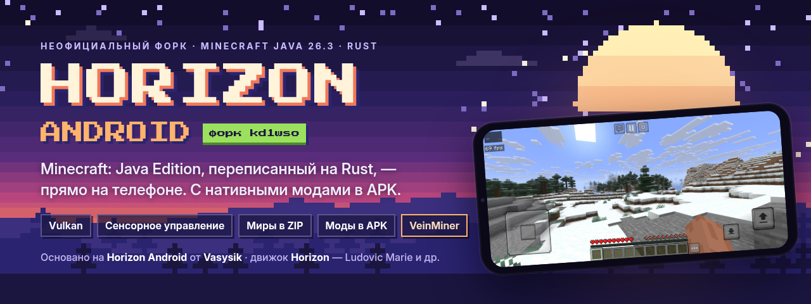
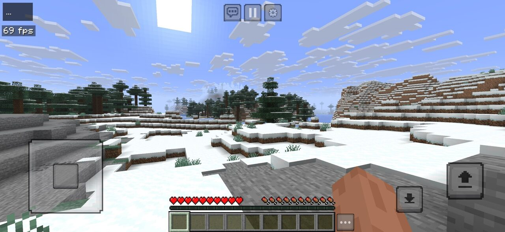
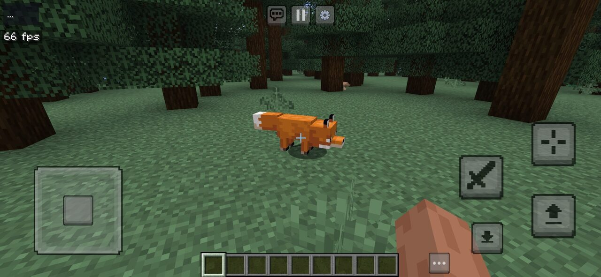
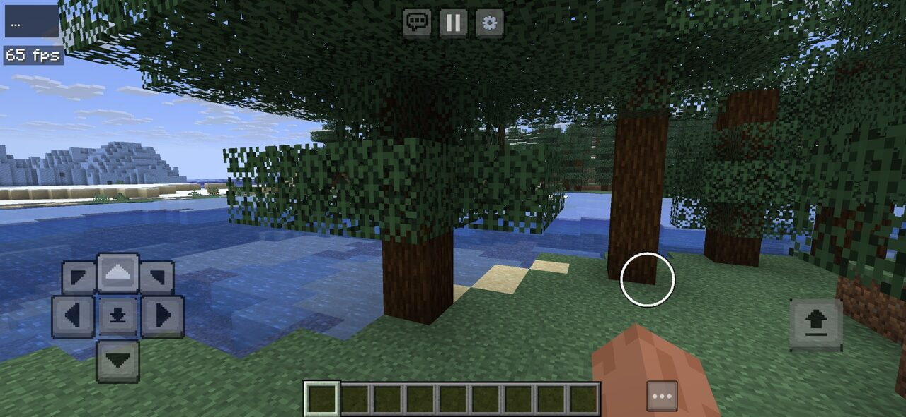
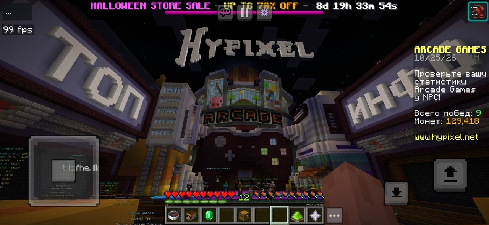

<div align="center">



<h1>Horizon Android · форк kd1wso</h1>

<p>
<b>Minecraft: Java Edition 26.3, переписанный на Rust, — нативно на Android.</b><br>
Vulkan, сенсорное управление, миры в ZIP и нативные моды прямо в APK.
</p>

<p>
<a href="https://github.com/kd1wso/horizon-android-kd1wso/releases/latest"></a>
</p>

<p>
<a href="https://github.com/kd1wso/horizon-android-kd1wso/actions/workflows/android-dev.yml"></a>
<a href="https://github.com/kd1wso/horizon-android-kd1wso/releases"></a>


<a href="LICENSE"></a>
</p>

<p>
<a href="https://github.com/Vasysik/horizon-android"></a>
</p>

</div>

> [!NOTE]
> **Это неофициальный форк.** Оригинальный Android-порт и лаунчер —
> [**Horizon Android**](https://github.com/Vasysik/horizon-android) от [**Vasysik**](https://github.com/Vasysik),
> движок — [**Horizon**](https://github.com/horizon-rust/horizon) от Ludovic Marie и контрибьюторов.
> Почти весь код — их работа; форк добавляет поверх неё несколько функций (они перечислены ниже).
> Не является официальным продуктом Minecraft, не одобрен Mojang или Microsoft и не связан с ними.

## ✨ Что нового в форке

- 🌅 **Шейдеры Lux 1.2 прямо в APK.** Сборка Lux для Horizon от [**@GBanan**](https://github.com/GBanan),
  настроенная для телефонов, сама появляется в `shaderpacks/`: включи её на вкладке **Installed**
  или в игре. [Подробнее](#-шейдеры-lux).
- 🌍 **Миры в ZIP.** Новая страница **Worlds** в лаунчере: список миров из `saves/`,
  **Import** — импорт мира из ZIP, **Export** — экспорт в `<мир>.zip`,
  **Open folder** — папка миров в «Файлах» (Horizon Android → Worlds).
  Миры можно переносить между телефонами и сборками.
- 🎨 **Скины и плащи** (0.7.8). Новая страница **Skins**: **Choose PNG** открывает системный
  проводник — выбери скин 64×64 (или старый 64×32) и, если хочешь, плащ 64×32.
  **Model** — руки **Classic** (4 px) или **Slim** (3 px), рядом — предпросмотр спереди.
  Скин надевается со следующего **Play** в офлайн-игре; видишь его только ты, а с аккаунтом
  Microsoft остаётся скин аккаунта. [Подробнее](docs/android.md#skins).
- 🌌 **Новый вид лаунчера.** Ночной пиксельный стиль: звёздное небо и замок в фиолетовом
  тумане, пиксельный логотип, фиолетовые вкладки и кнопки со «ступенчатыми» углами,
  страницы на тёмных полупрозрачных карточках. Кнопка **GitHub** рядом с **Play** открывает
  этот репозиторий.
- 🧩 **Нативные моды прямо в APK.** Моды в формате horizon-mixins (как `.hnmod` у десктопного
  лаунчера) лежат в `mods/android-native/` и собираются в APK — локально и в CI.
  Есть шаблон и проверка, подробности — [ниже](#-нативные-моды).
- ⛏️ **VeinMiner.** Первый мод: присядь и сломай руду или бревно — вместе с ним сломается
  вся жила или весь ствол. [Подробнее](mods/android-native/veinminer/README.md).
- 🤖 **APK из GitHub Actions.** Каждый пуш в `android` собирает оптимизированный APK,
  готовые сборки — в [Releases](https://github.com/kd1wso/horizon-android-kd1wso/releases).

## 📸 Скриншоты

<table>
  <tr>
    <td width="50%"></td>
    <td width="50%"></td>
  </tr>
  <tr>
    <td align="center"><sub>Пейзажи на Vulkan</sub></td>
    <td align="center"><sub>Джойстик и кнопки действий</sub></td>
  </tr>
  <tr>
    <td width="50%"></td>
    <td width="50%"></td>
  </tr>
  <tr>
    <td align="center"><sub>Схема с D-pad</sub></td>
    <td align="center"><sub>Мультиплеер на Java-серверах</sub></td>
  </tr>
</table>

<sub>Скриншоты — из оригинального репозитория <a href="https://github.com/Vasysik/horizon-android">Horizon Android</a>.</sub>

## 🎮 Возможности

Всё это досталось от оригинального Horizon Android:

- Нативный клиент Minecraft: Java Edition **26.3** на Rust — одиночная игра и мультиплеер
  на Java-серверах. Другие версии и JAR-файлы он не запускает.
- Рендер: **Vulkan** (GPU batching или режим совместимости) и экспериментальный **OpenGL ES**.
- Редактируемое сенсорное управление: джойстик или D-pad, прицел или тап.
  Также клавиатура и мышь, кнопочные телефоны и (экспериментально) Android TV.
- Вход через аккаунт **Microsoft** или офлайн-игра со своим ником.
- Ресурс-паки с проверкой контрольных сумм и моды `.hmod` по прямой HTTPS-ссылке.
- Ресурсы игры скачиваются прямо на телефоне с официальных серверов Mojang — ни ПК, ни Java не нужны.

## 📲 Установка

1. Скачай `…-arm64-v8a.apk` из [последнего релиза](https://github.com/kd1wso/horizon-android-kd1wso/releases/latest)
   (Android 9+, 64-битный ARM).
2. Установи APK — Android может попросить разрешить установку из этого источника.
3. Открой Horizon и нажми **Download Minecraft 26.3**. Скачается около 500 МиБ с серверов Mojang;
   если загрузка прервётся, уже проверенные файлы не придётся качать заново.
4. Нажми **Play**. Дальше можно играть офлайн. Для серверов с авторизацией нужен
   лицензионный аккаунт Microsoft (**Accounts**).

> [!TIP]
> Сборки форка ставятся отдельным приложением (пакет `dev.horizon.android.dev`) рядом с оригинальным
> Horizon Android и его данных не трогают. Миры у них разные — перенеси их через **Worlds → Export / Import**.

> [!IMPORTANT]
> Миры сохраняются при обновлении, только если новый APK подписан тем же ключом. Если Android
> не даёт установить сборку поверх старой, сначала экспортируй миры в ZIP: удаление приложения стирает его данные.

## 🧩 Нативные моды

Нативные моды (бандлы horizon-mixins, они же `.hnmod` у десктопного лаунчера) меняют сам Rust-код игры.
Телефон не может ни скомпилировать, ни загрузить такой код, поэтому моды вшиваются в APK во время сборки:

```bash
python3 tools/android_native_mods.py new my_mod   # новый мод из шаблона _example/
python3 tools/android_native_mods.py check        # проверка модов
git push                                          # CI соберёт APK вместе с модом
```

Готовый `.hnmod` достаточно положить в `mods/android-native/`. Вшитые моды видны на вкладке
**Mods** лаунчера (кнопки **Enable** / **Disable**) и в игре в **Options → Mods**. Полное руководство — [docs/android-native-mods.md](docs/android-native-mods.md).

### ⛏️ VeinMiner

Присядь (или включи режим **Always**) и сломай руду или бревно подходящим инструментом —
вместе с ним сломается вся жила или весь ствол.

- **Руды** — ванильные руды по тегам: обычная и глубинносланцевая ломаются вместе.
  Другие `*_ore` и древние обломки — только такой же блок.
- **Брёвна** — тег `minecraft:logs`, только такое же бревно.
- **Лимит** — 16–256 блоков за раз, по умолчанию 64 (вместе с первым).
- **Честно** — каждый блок ломается как обычный удар игрока: Удача, Шёлковое касание, износ,
  опыт, голод, статистика, защита мира. Дроп и опыт падают на месте первого блока.
- **Бережно** — останавливается до того, как инструмент сломается; в творческом режиме не работает.
- **Где** — одиночная игра и мир, открытый для LAN (у гостей тоже); на чужих серверах — нет.
- **Вкл/выкл** — включён по умолчанию; выключается на вкладке **Mods** лаунчера или в **Options → Mods**.
- **Настройки** — **Options → Mods → VeinMiner**, команда `/veinminer` в чате.

## 🌅 Шейдеры Lux

В APK встроен шейдерпак **Lux v1.2** в сборке для Horizon от [**@GBanan**](https://github.com/GBanan):
[GBanan/Lux-1.2-Shaders-For-Horizon](https://github.com/GBanan/Lux-1.2-Shaders-For-Horizon). Лаунчер сам кладёт его в `shaderpacks/`
профиля: включи **Lux_v1.2_Horizon_Android.zip (built in)** на вкладке **Installed** или в игре
(**Options → Horizon Settings → Shader Packs**).

Для телефонов изменены только настройки по умолчанию (профиль **Android**): тени 1024 на 128 блоков
с простым фильтром, FXAA вместо TAA, без AO, объёмного света, размытых отражений и параллакса воды.
Отражения в воде, цветные мягкие тени, облака, сияние и блум остались. На мощном телефоне выбери
**Shader Options… → Profile → Medium** или **High**: это настройки оригинала. Все изменения —
в [ANDROID.txt](shaders/android-native/Lux_v1.2_Horizon_Android/ANDROID.txt).

Вшить можно и свой шейдерпак: положи его папку (с `shaders/` внутри) или `.zip` в
`shaders/android-native/`, и следующий APK принесёт его. Проверка —
`python3 tools/android_shader_packs.py check`, подробности — в
[shaders/android-native/README.md](shaders/android-native/README.md).

Lux сделал [TechDevOnGithub](https://github.com/TechDevOnGithub) на основе BSL Shaders от Capt Tatsu
([bitslablab.com](https://bitslablab.com)), а для Horizon его перенёс и исправил [@GBanan](https://github.com/GBanan).
Спасибо, [@GBanan](https://github.com/GBanan), за порт и разрешение переносить его дальше!

## 🛠️ Сборка

- APK из исходников (Rust, Android SDK/NDK) — [docs/android.md → Build](docs/android.md#build-developers-only).
- Dev-сборки в GitHub Actions и ключ подписи — [docs/android-dev-builds.md](docs/android-dev-builds.md).
- Игровые файлы, подготовленные ресурсы, аккаунты, APK и ключи в Git не попадают —
  это проверяет `tools/check_public_tree.py`.

## 💜 Авторы и благодарности

<table>
  <tr>
    <td align="center" width="25%">
      <a href="https://github.com/Vasysik"><br><b>Vasysik</b></a><br>
      <sub>Автор оригинального лаунчера и Android-порта<br><a href="https://github.com/Vasysik/horizon-android">Vasysik/horizon-android</a></sub>
    </td>
    <td align="center" width="25%">
      <a href="https://github.com/ludovic111"><br><b>Ludovic Marie</b></a><br>
      <sub>Автор движка Horizon (вместе с контрибьюторами)<br><a href="https://github.com/horizon-rust/horizon">horizon-rust/horizon</a></sub>
    </td>
    <td align="center" width="25%">
      <a href="https://github.com/GBanan"><br><b>@GBanan</b></a><br>
      <sub>Шейдеры Lux 1.2 для Horizon<br><a href="https://github.com/GBanan/Lux-1.2-Shaders-For-Horizon">GBanan/Lux-1.2-Shaders-For-Horizon</a></sub>
    </td>
    <td align="center" width="25%">
      <a href="https://github.com/kd1wso"><br><b>kd1wso</b></a><br>
      <sub>Этот форк: миры в ZIP,<br>нативные моды, VeinMiner</sub>
    </td>
  </tr>
</table>

Оригинальный Android-порт и лаунчер сделал **[Vasysik](https://github.com/Vasysik)**.
Стабильные сборки и новости оригинала — в его репозитории
[Vasysik/horizon-android](https://github.com/Vasysik/horizon-android).
Поддержать автора: [Boosty](https://boosty.to/vasys) · сообщество в [Discord](https://discord.gg/PG79z2PhjG).

Шейдеры Lux для Horizon перенёс **[@GBanan](https://github.com/GBanan)**: [GBanan/Lux-1.2-Shaders-For-Horizon](https://github.com/GBanan/Lux-1.2-Shaders-For-Horizon).

## 📄 Лицензия

Код распространяется по лицензии **MIT** — см. [LICENSE](LICENSE). Копирайт
«Ludovic Marie and the Horizon contributors» сохранён, изменения форка распространяются на тех же условиях.
Сторонние компоненты и их лицензии — в [THIRD_PARTY_NOTICES.md](THIRD_PARTY_NOTICES.md).

Шейдерпак Lux в `shaders/android-native/` под MIT не подпадает: он распространяется по GPL-2.0
([LICENSE](shaders/android-native/Lux_v1.2_Horizon_Android/LICENSE)) и на условиях BSL Shaders
([AGREEMENT.txt](shaders/android-native/Lux_v1.2_Horizon_Android/AGREEMENT.txt)).

Ресурсы Minecraft (текстуры, звуки) в репозиторий не входят и не подпадают под MIT: лаунчер
скачивает их на устройстве с официальных серверов Mojang. Minecraft и его ресурсы принадлежат Mojang и Microsoft.

<div align="center">
<br>
<sub>Нравится проект? Поставь ⭐ этому форку и <a href="https://github.com/Vasysik/horizon-android">оригиналу</a>.</sub>
</div>